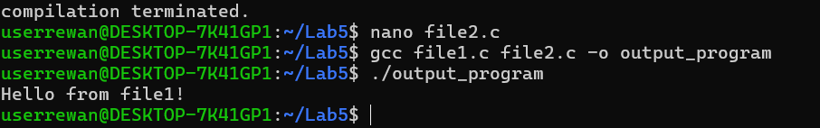
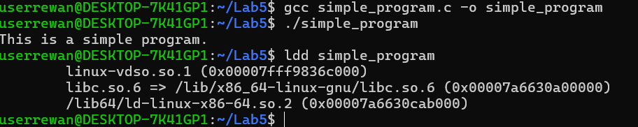
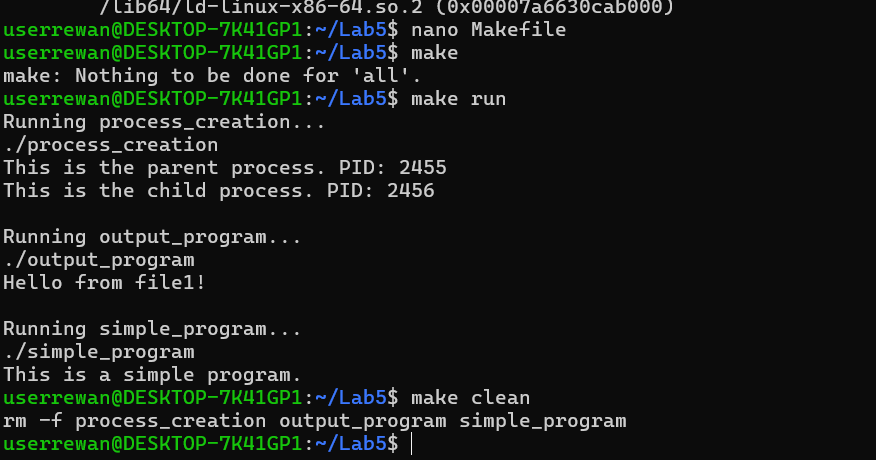

# OS Process Management Lab

Exercises from **Lab 5: Process Management** of an Operating Systems course. Three small C programs show process creation with `fork()`, the role of the linker when two source files are combined, and the role of the loader and shared libraries (inspected with `ldd`). A Makefile builds and runs all three programs.

## Exercises

| # | Source | Executable | What it demonstrates |
|---|---|---|---|
| 1 | `process_creation.c` | `process_creation` | `fork()` creates a child process. The return value identifies the child (`0`), the parent (`> 0`) or a failure (`< 0`). Each process prints its own PID with `getpid()`. |
| 2 | `file1.c` + `file2.c` | `output_program` | Linking: `file1.c` defines `hello()`, and `file2.c` declares it and calls it from `main()`. The linker resolves the cross-file reference. |
| 3 | `simple_program.c` | `simple_program` | Loading: a minimal program whose shared-library dependencies can be listed with `ldd simple_program`. |

`lab5.txt` contains the source of each exercise, followed by the written explanations of `fork()`, the linker and the loader.

## Project structure

```text
.
├── process_creation.c   # Exercise 1: fork()
├── file1.c              # Exercise 2: defines hello()
├── file2.c              # Exercise 2: main() calls hello()
├── simple_program.c     # Exercise 3: loader / ldd demo
├── Makefile             # Targets: all, run, clean
├── lab5.txt             # Lab answers and explanations
├── process_creation     # Committed build output (x86-64 Linux ELF)
├── output_program       # Committed build output (x86-64 Linux ELF)
├── simple_program       # Committed build output (x86-64 Linux ELF)
├── 0.png 1.png 2.png 3.png 4.png a.png b.png   # Terminal / editor screenshots
├── LICENSE
└── README.md
```

## Getting started

### Prerequisites

- A Linux (or other POSIX) environment with `gcc` and `make`. `fork()` and `unistd.h` are POSIX APIs and are not available in a native Windows toolchain.
- `ldd` (part of glibc on Linux) for exercise 3.

### Build and run

```bash
git clone https://github.com/Rewanooo22/os-process-management-lab.git
cd os-process-management-lab

make clean    # remove the committed binaries so they are rebuilt for your machine
make          # builds process_creation, output_program and simple_program (gcc -Wall -g)
make run      # builds if needed, then runs all three programs in order
```

To run the programs one at a time:

```bash
./process_creation
./output_program
./simple_program
ldd simple_program
```

### Makefile targets

| Target | Action |
|---|---|
| `all` (default) | Compiles the three executables with `gcc -Wall -g` |
| `run` | Depends on `all`, then runs `./process_creation`, `./output_program` and `./simple_program` |
| `clean` | `rm -f process_creation output_program simple_program` |

The Makefile has no target that runs `ldd`; run it manually as shown above.

## Example output

These lines come from the committed screenshots. PIDs and library addresses differ on every run.

```text
$ ./process_creation
This is the parent process. PID: 2565
This is the child process. PID: 2566

$ ./output_program
Hello from file1!

$ ./simple_program
This is a simple program.
```

The parent and child messages can appear in either order, because scheduling decides which process runs first.

### Screenshots

Linking `file1.c` and `file2.c` into `output_program`:



Running `simple_program` and listing its shared libraries with `ldd`:



Building and running everything with `make`, `make run` and `make clean`:



Other screenshots in the repository: `a.png` and `b.png` show the exercises compiled and run by hand, `1.png` shows `file1.c` in an editor, and `0.png` shows the toolchain installation and the first `process_creation` run.

## Notes

- The committed binaries are x86-64 Linux executables. Rebuild them with `make clean && make` instead of relying on them. If they are present and newer than the sources, `make` reports "Nothing to be done for 'all'".
- These are introductory lab exercises. `process_creation.c` does not call `wait()`, so the parent may exit before the child prints.

## Context

Lab 5 (Process Management) of an Operating Systems course.

## License

Released under the [MIT License](LICENSE).
